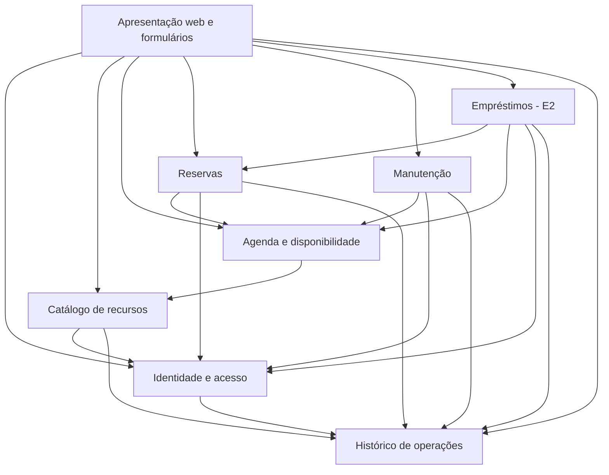
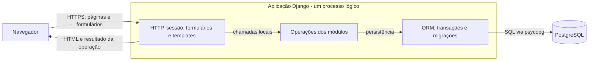
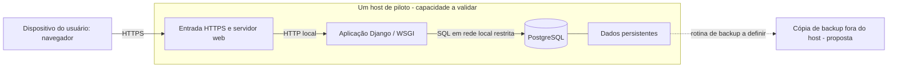

# 5. Visões arquiteturais iniciais

Status: visão alvo com realização parcial. BL-02 implementa a base de Identidade, Histórico e apresentação; os módulos de recursos, agenda, reservas, manutenção e empréstimos ainda não estão na aplicação. A prova isolada de agenda não equivale à implementação modular. As três visões atendem às seções 4.1–4.4 do roteiro. As setas do primeiro diagrama representam dependência lógica; as demais mostram comunicação e localização.

## Visão de módulos

Público: equipe e avaliadores. Preocupações: responsabilidades, testabilidade, consistência e controle de acoplamento (INT-04/INT-05; RNF-01/RNF-05).

| Módulo | Responsabilidade e interface conceitual |
| --- | --- |
| Identidade e acesso | Contas, sessões, perfis e habilitações; verificar identidade/capacidade e administrar concessões |
| Catálogo | Laboratórios, equipamentos, requisitos de habilitação e vínculos de responsabilidade; consultar recurso, validar alcance e inativar |
| Agenda | Ocupações comuns e marcadores operacionais; consultar disponibilidade, ocupar/liberar período e coordenar bloqueio do recurso |
| Reservas | Solicitação, análise, cancelamento e política de estados; depende da agenda para ocupar/liberar |
| Manutenção | Registro, intervalo e encerramento de intervenções; depende da agenda para bloquear/liberar |
| Empréstimos (E2) | Custódia física, retirada/devolução e atraso; consulta reserva e agenda para validar uso |
| Histórico | Gravar eventos e fornecer consultas com escopo já autorizado; não altera decisões de outros módulos |
| Apresentação | Rotas, views, formulários e templates; compõe consultas e invoca operações, sem gravar tabelas diretamente |

Identidade mantém papéis e concessões por código de habilitação, sem depender do Catálogo. O vínculo usuário–laboratório e as exigências por recurso pertencem ao Catálogo. Histórico recebe identificadores e dados mínimos de evento, sem importar módulos de negócio. Essas escolhas mantêm o grafo sem ciclos.

A disponibilidade combina períodos planejados com marcadores operacionais mantidos pela Agenda. A apresentação e os comandos usam essa mesma consulta. Agenda não consulta Manutenção ou Empréstimos de volta.

### Contratos que atravessam módulos

Manutenção registra na Agenda o marcador de intervenção não encerrada, com prazo e origem, e o encerra junto à origem na mesma transação. Quando o relógio ultrapassa o prazo de um marcador aberto, a consulta indica atraso e suspende novas aprovações. Em E2, Empréstimos usa o mesmo princípio para custódia aberta. Não há job necessário apenas para mudar o estado para atrasado: ele é calculado pelo prazo e pelo encerramento. Esses marcadores não são editáveis diretamente na interface.

A Agenda pode, assim, checar a condição atual sem depender dos módulos chamadores. Os testes de atomicidade devem conferir a correspondência entre origem, ocupação e marcador. O modelo físico desses dados será definido na prova BL-01; a política de suspender novas aprovações é uma hipótese a validar em P-06.

## Visão de componentes e conectores

Público: equipe, operadores e avaliadores. Preocupações: onde as regras executam, quais conexões existem e onde está a transação.

Os módulos executam no mesmo processo lógico da aplicação, mesmo que o servidor tenha mais de um worker. As conexões ao banco são distintas por execução; a proteção não pode depender de variável global ou trava em memória. PostgreSQL mantém restrições e bloqueios compartilhados. A transação de uma aprovação inclui dados de Reservas, Agenda e Histórico no mesmo banco. Não há fila, broker ou serviço remoto no fluxo.

No desenvolvimento local pode haver HTTP em loopback. HTTPS é a proposta para eventual piloto acessível pela rede. Não existe endpoint externo publicado nem API pública implementada.

## Visão de implantação

Público: INT-04/INT-06. Preocupações: instalação simples, acesso ao banco e recuperação. Ambiente alvo ainda não contratado; este é um candidato para piloto pequeno.

Aplicação e banco podem coexistir em um host para reduzir operação, assumindo ponto único de falha. Dados persistentes e backup são necessários ao eventual uso real, mas nenhuma infraestrutura foi provisionada. O banco não precisa estar exposto aos navegadores. O mecanismo de HTTPS, servidor WSGI, sistema operacional, destino do backup e responsáveis serão definidos em P-09.

Para desenvolvimento, a alternativa mínima é Python/venv e PostgreSQL na estação; container do banco é opcional. Não se pressupõem Kubernetes, serviços gerenciados ou múltiplos ambientes já existentes.

## Relação e rastreabilidade entre as visões

| Elemento lógico | Realização em execução | Localização proposta | Preocupação e evidência |
| --- | --- | --- | --- |
| Apresentação | HTTP, formulários e templates | Aplicação WSGI no host | Usabilidade e sessão: RNF-02/RNF-06, CQ-03/CQ-08 |
| Identidade, Catálogo, Reservas, Manutenção e Empréstimos | Operações chamadas localmente | Mesma aplicação | Autorização/estados: RF-01 a RF-12, CQ-03/CQ-04/CQ-10 |
| Agenda | Operações locais, ORM e restrição de exclusão | Aplicação + PostgreSQL | Conflitos: RNF-01, CQ-01/CQ-02 |
| Histórico | Escrita transacional e consulta autorizada | Aplicação + PostgreSQL | Rastreabilidade: RF-13, CQ-05 |
| Persistência de todos os módulos | Tabelas e migrações no mesmo banco | Volume persistente do host | Atomicidade e recuperação: CQ-05/CQ-07 |

Módulo não equivale a serviço implantável. Uma futura separação do banco em outro host altera a implantação, sem obrigar a reescrever as responsabilidades lógicas. Separar Reservas e Manutenção em serviços, por outro lado, altera a coordenação transacional e exige nova decisão arquitetural.

## Correspondência com o código atual — BL-02

| Elemento da visão alvo | Realização atual | Limite |
| --- | --- | --- |
| Apresentação | Rotas em `kdlab/`, views/forms em `apps/identidade/`, `templates/` e `static/` | Login, logout e própria conta; sem telas de recursos/reservas |
| Identidade | `apps/identidade/`, com `Usuario(AbstractUser)` e admin | Contas locais e sessão; perfis/vínculos/habilitações do produto pendentes |
| Histórico | `apps/historico/`, chamado pela administração de identidade | Eventos de contas com ator e consulta técnica; sem eventos dos módulos ainda não implementados |
| Execução | Django/WSGI e PostgreSQL com conexão SQL local | Uma aplicação; receitas em [README](../README.md) |
| Implantação | Desenvolvimento local com PostgreSQL opcional em Compose | Nenhum host de piloto, backup operacional ou publicação foi provisionado |

Evidências da realização parcial: [BL-02](12-base-identidade.md).
