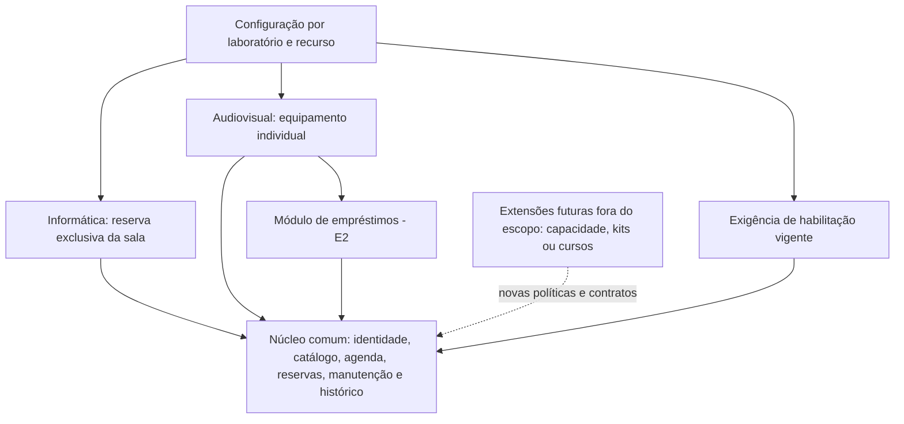

# 6. Domínio, variabilidade e reutilização

Esta é uma proposta de arquitetura de domínio reutilizável. Não existe uma linha de produtos já implementada nem evidência de que seja necessário gerar aplicações diferentes. A recomendação inicial é uma instalação comum, configurada para diferentes laboratórios.

## Núcleo comum

Identidade, Catálogo, Agenda, Reservas, Manutenção e Histórico atendem a todos os tipos de laboratório. Empréstimos complementa o núcleo quando existe movimentação física de equipamentos. Os mesmos estados, verificações de autorização e proteção contra conflitos devem valer para todos.

| Conceito comum | Relações e informação mínima propostas |
| --- | --- |
| Usuário e perfil | Conta ativa, capacidades e concessões de habilitação |
| Laboratório | Identificação, localização e vínculos de responsabilidade |
| Recurso | Identificador único, tipo, laboratório associado, ativo, reservável e exigências de habilitação |
| Reserva | Um solicitante, um recurso, intervalo, finalidade, estado e decisão |
| Ocupação | Um recurso, intervalo bloqueante e ligação a uma reserva aprovada ou manutenção |
| Marcador operacional | Recurso, origem, tipo, prazo e encerramento; permite detectar manutenção/custódia em atraso |
| Manutenção | Recurso, intervalo planejado, motivo, estado e término registrado |
| Empréstimo (E2) | Uma reserva aprovada de equipamento, retirada, recebedor, operador e devolução |
| Evento de histórico | Ator, instante, ação, alvo e resultado com dados mínimos |

Restrições comuns: intervalos válidos, recurso exclusivo, uma ocupação por origem, uma retirada por reserva, transições válidas e ausência de exclusão histórica. A definição de laboratório como espaço e como recurso reservável deve evitar duplicar sua identidade; o modelo físico será detalhado na implementação.

## Três aplicações do mesmo núcleo

| Contexto | Configurações suficientes ao escopo inicial | Variação que mudaria o comportamento |
| --- | --- | --- |
| Laboratório de informática | Reservar a sala inteira, cadastrar localização e responsáveis; computadores podem ser apenas identificados ou recursos individuais, se esse for o processo escolhido | Reservar assentos por capacidade compartilhada ou bloquear todos os computadores ao reservar a sala exige nova política de alocação e conflitos hierárquicos |
| Equipamentos audiovisuais | Cadastrar projetor/câmera individual, habilitar empréstimo em E2 e definir quem pode retirar | Kit com vários itens obrigatórios e retirada parcial exige componente de composição de kit e movimentações por item |
| Laboratório com treinamento obrigatório | Configurar códigos de habilitação exigidos; administrador registra concessão, validade e revogação; mesma política de acesso consulta esses dados | Gerenciar oferta de cursos, provas, instrutores e certificação exige componente próprio de treinamento; não é um campo adicional de cadastro |

Em todos os casos a reserva continua exclusiva por recurso em E1. Informar capacidade da sala como metadado não significa permitir reservas concorrentes até essa capacidade. Localizar um projetor em uma sala não cria, por si só, uma dependência de reserva entre eles. Essas regras ficam abertas em P-02.

## Configuração versus componente próprio

**Configuração** altera dados ou ativa um comportamento já suportado: tipo do recurso, vínculo do responsável, exigência de uma habilitação e possibilidade de empréstimo. Não criar classes diferentes apenas porque um recurso é chamado de câmera ou computador. Quantidade e tipos de habilitação são dados, sem exigir um serviço de treinamento.

**Componente próprio** se justifica quando há ciclo de vida, dados e regras novos: alocação por capacidade, composição de kits ou formação/certificação. Cada um precisa de requisitos e testes adicionais. As extensões podem continuar como módulos do monólito; variabilidade não implica processos ou bancos separados.

Horários de funcionamento, duração máxima e margens entre reservas são candidatos a configuração depois de suas políticas serem definidas e implementadas. Não são recursos já disponíveis nem necessários ao primeiro protótipo descrito aqui.

## Representação da solução

As setas representam uso do núcleo e escolhas de configuração, não um novo grafo de importações. As dependências de código são as da [visão de módulos](05-visoes.md).

## Reutilização proposta

Manter uma base de código e migrações comuns; cadastrar variações como dados; testar a mesma agenda com exemplos dos três contextos. Não copiar o módulo de Reservas para cada laboratório, nem manter forks por tipo de equipamento. Caso uma extensão real seja aprovada, adicioná-la por uma operação explícita e testar o contrato que ela usa no núcleo, preservando a mesma proteção transacional.
